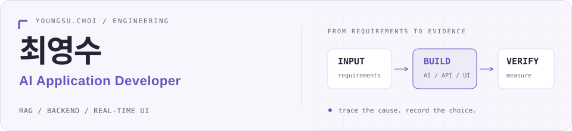

  <picture>
    <source media="(prefers-color-scheme: dark)" srcset="./assets/profile-header-dark.svg" />
    
  </picture>

**AI 서비스의 병목을 풀고, 선택의 근거를 남깁니다.**

안녕하세요, 최영수입니다. Python·FastAPI와 React로 AI 기능을 사용자의 화면까지 연결합니다.
기술영업에서 고객의 요청을 실행 조건으로 구체화했던 경험을 바탕으로, 지연의 원인과 검증 조건을 코드 옆에 기록합니다.

  
  
  

## 함께 만든 서비스

### 01 · [Jobiverse](https://github.com/youngsuchoi0930/job_simulator)

**사용자가 생각하는 시간까지, 응답 지연의 조건에 넣었습니다.**

AI 아바타 상담과 직무 체험을 연결한 6인 팀 프로젝트입니다.
코치·NPC 프롬프트, 미니게임, RAG 지식베이스와 추천 보정을 담당했습니다.

- 상담처럼 **20~40초 간격**으로 요청할 때 HTTP 연결이 다시 맺어지는 원인을 찾고, 연결 유지 시간을 5초에서 300초로 조정했습니다.
- 운영 VM **21턴 재측정**에서 첫 응답 p50 **2,591 → 1,550ms**, 임베딩 **1,262 → 343ms**를 확인했습니다.

`Python` `FastAPI` `pgvector` `React` `Gemini`

[시연 영상](https://www.youtube.com/watch?v=NnnkidKIjAQ) · [개선 커밋](https://github.com/youngsuchoi0930/job_simulator/commit/9eb278967bed2d2328b6fe49a94b0c8f0d017bb8) · [측정 기록](https://github.com/youngsuchoi0930/job_simulator/blob/main/docs/evaluation/평가지표_결과보고서_v2.md)

### 02 · [야구 볼래](https://github.com/youngsuchoi0930/KBO_coach)

**캐릭터의 움직임을 살리면서, 모델의 무게를 줄였습니다.**

구단별 챗봇과 3D 캐릭터로 야구 입문을 돕는 6인 팀 프로젝트입니다.
React·Capacitor 공통 UI, 디자인, 3D 캐릭터를 담당했습니다.

- 재질·리깅·애니메이션을 보존하며 Draco·WebP를 적용해 **725 → 56.7MB**로 경량화하고, **10개 구단 스킨**을 연결했습니다.
- 모션 전환의 깜빡임은 크로스페이드로 줄이고, 배트를 제외한 몸통 기준으로 캐릭터 중심을 보정했습니다.

`TypeScript` `React` `Capacitor` `three.js` `Draco` `WebP`

[시연 영상](https://youtu.be/63MPROcGLFI) · [모델·스킨·모션 작업](https://github.com/youngsuchoi0930/KBO_coach/commit/28df586584b5c8f86075173c2b038766a0b1bc8a) · [중심 보정](https://github.com/youngsuchoi0930/KBO_coach/commit/6cd4a4a038f8f27ad03cd32b2ea68c43864d10c2)

수치는 모델 파일 용량입니다. iOS 전용 화면 보정과 TestFlight 구성은 팀원이 담당했습니다.

### 03 · [피어나](https://github.com/youngsuchoi0930/KSL-Project)

**손을 따라오지 못하던 화면에서, 기다리는 경로를 분리했습니다.**

주민센터의 수어·음성 소통을 돕는 4인 팀 프로젝트입니다.
키오스크·상담원 UI, DB 변경, 배포와 실환경 최적화를 담당했습니다.

- 손 검출을 브라우저로 옮긴 뒤에도 남은 지연을 추적해, **화면 그리기와 서버 전송을 분리**했습니다.
- 배포 환경에서 손 좌표 화면 갱신율을 **6 → 30~40fps**로 개선했습니다.
- 기존 데이터를 보존하는 지점 식별자 마이그레이션과 암호화 실패 시 저장 중단을 구현하고, Vercel·Cloud Run 시그널링·GCP VM의 자동배포를 구성했습니다.

`TypeScript` `React` `MediaPipe` `Flask` `SQLite` `WebRTC` `GCP`

[진단·개선 기록](https://github.com/youngsuchoi0930/KSL-Project/blob/main/docs/랜드마크_지연개선_2026-06-26.md) · [그리기·전송 분리](https://github.com/youngsuchoi0930/KSL-Project/commit/43685675b63adf22dae7f7fc0677e61ec15908fb) · [배포 구성](https://github.com/youngsuchoi0930/KSL-Project/blob/main/deploy/README.md)

화면 갱신율 기준입니다. 모델 학습과 인식 정확도 평가는 팀원이 담당했습니다.

> **팀으로 만든 성과** — Jobiverse와 야구 볼래는 이스트소프트 KDT 과정에서 각각 **6개 팀 중 1위**로 대상을 받았습니다. 각 6인 팀으로 참여했으며 평가 기준은 기획성·창의성·엔지니어의 가치입니다.

## AI 문서·검색 실험

### 04 · [RentGuard](https://github.com/youngsuchoi0930/RentGuard)

**문서의 값과 모델의 설명 사이에, 확인할 근거를 남깁니다.**

등기부·건축물대장·임대차계약서의 PDF 텍스트와 PaddleOCR 추출 결과를 교차검증합니다.
규칙·보증금 분위수 모델의 판단과 Gemini 설명을 나누고, 전송 정보 제한·출력 검증·실패 시 대체 응답을 구현했습니다.

- 보증금 모델은 현재 제안 보증금을 입력에서 제외하고, **시간순 학습·보정·홀드아웃**으로 평가합니다.
- **2026.10.12 CI:** API 테스트 **137개 통과·1개 제외**, 합성 문서 **30사례·480필드** 회귀검증 통과와 웹 빌드를 확인했습니다.

`Python` `FastAPI` `Next.js` `PaddleOCR` `scikit-learn` `Gemini`

[LLM 설명 제어](https://github.com/youngsuchoi0930/RentGuard/blob/main/apps/api/app/services/llm_explainer.py) · [모델 학습·평가](https://github.com/youngsuchoi0930/RentGuard/blob/main/scripts/train_deposit_quantile.py) · [CI 실행 기록](https://github.com/youngsuchoi0930/RentGuard/actions/runs/38234381249)

CI 수치는 해당 합성 문서와 테스트의 검증 결과입니다. 실제 계약 문서 전반의 정확도나 사기 탐지 성능을 뜻하지 않습니다.

### 05 · [ManualGo](https://github.com/youngsuchoi0930/manualgo)

**좋은 검색 점수가, 좋은 평가 질문에서 나왔는지 확인했습니다.**

기기를 다루면서 음성으로 질문하면 매뉴얼의 근거 페이지와 함께 답하는 개인 프로젝트입니다.
96종 매뉴얼의 수집·파싱부터 검색, 음성 응답, 출처 UI와 평가까지 구현했습니다.

- 정답을 유지하고 질문만 구어체로 바꾼 **200문항**에서 제품 선택 R@1이 **0.815 → 0.495**로 떨어져 평가셋의 표현 편향을 확인했습니다.
- 재작성한 **640문항**을 구성 선택·검증 각 320개로 분리하고 검색 경로를 조정해, **홀드아웃 320문항 R@5 0.878**을 확인했습니다.
- 로컬 ONNX 임베딩·리랭커를 구성하고, **6GB GPU 메모리 제약**에 맞춰 컴포넌트별 CPU·GPU 실행 장치를 분리했습니다.

`Python` `FastAPI` `ChromaDB` `ONNX Runtime` `Azure Speech`

[평가 설계·실험표](https://github.com/youngsuchoi0930/manualgo/blob/main/README.md) · [튜닝·홀드아웃 평가 코드](https://github.com/youngsuchoi0930/manualgo/blob/main/evaluation/tune_report.py) · [ONNX 실행 구성](https://github.com/youngsuchoi0930/manualgo/blob/main/rag/onnx_runtime.py)

200문항의 표현 변경 실험과 320문항 홀드아웃은 별도 평가입니다. 질문은 구어체 재작성 자료이며 실제 사용자 이용 데이터는 아닙니다.

## 자주 쓰는 도구

| 작업 | 사용 기술 |
| :--- | :--- |
| AI · 검색 · 문서 처리 | `ONNX Runtime` `scikit-learn` `PaddleOCR` `ChromaDB` `pgvector` |
| API · 데이터 | `Python` `FastAPI` `Flask` `PostgreSQL` `SQLite` |
| 화면 · 실시간 상호작용 | `TypeScript` `React` `Next.js` `Capacitor` `three.js` `WebRTC` |
| 배포 · 검증 | `Docker` `GCP` `Vercel` `GitHub Actions` `pytest` |

<b>개발을 시작하기 전의 경험</b>

 

**대성씨앤에스(주) · 기술영업 · 2023.03–2025.10**

2년 7개월 동안 고객 요구 분석, 사양 제안, 견적·수주, 납품·사후관리를 맡았습니다.
고객이 원하는 결과를 실행 가능한 조건으로 바꾸는 경험을 개발에서도 이어가고 있습니다.

**이스트소프트 KDT AI 휴먼과정 · 2026.03–2026.07 수료**

프로젝트에서 AI 기능을 API·화면·배포로 연결하고, 해결 전후를 측정하는 경험을 쌓았습니다.

<b>Contribution snake</b>

  <picture>
    <source media="(prefers-color-scheme: dark)" srcset="https://raw.githubusercontent.com/youngsuchoi0930/youngsuchoi0930/output/github-snake-dark.svg" />
    
  </picture>

---

**설계 선택이나 개선 과정을 함께 이야기하고 싶다면:** [y1692543@gmail.com](mailto:y1692543@gmail.com)

[포트폴리오](https://youngsu-resume.vercel.app) · [모든 저장소](https://github.com/youngsuchoi0930?tab=repositories)
